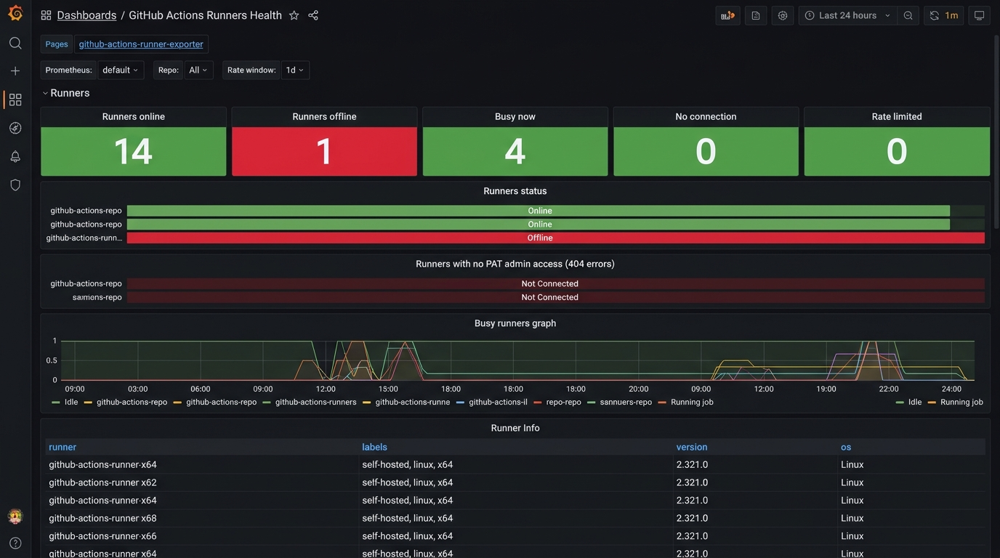

[](https://github.com/rezizter/github-runner-prometheus-exporter/actions/workflows/test.yml)
[](https://github.com/rezizter/github-runner-prometheus-exporter/releases/latest)
[](https://go.dev/doc/go1.26)
[](https://github.com/rezizter/github-runner-prometheus-exporter?tab=GPL-3.0-1-ov-file)
# Introduction
This is a Prometheus exporter, written in GO, that connects to the GitHub REST API and collects the status of GitHub Actions self-hosted runners.
It supports:

* Organization-level runners.
* Repository-level runners.
* Online/offline status.
* Busy/idle status.
* Runner counts and availability.
* Runner OS, labels and version.
* Prometheus metrics.
* Alert Manager rules.
* Automatic polling of GitHub.
* API error and exporter health monitoring.

Included is a dashboard for Grafana to display the metrics [dashboards/github_actions_runners_dashboard.json](https://github.com/rezizter/github-runner-prometheus-exporter/blob/main/dashboards/github_actions_runners_dashboard.json).


# Install
Clone this repo:
```
git clone https://github.com/rezizter/github-runner-prometheus-exporter.git
cd github-runner-prometheus-exporter
```

Build the package for your operating system:
```
go build -o github-runner-prometheus-exporter ./main.go
```

# Configure GitHub authentication
[Create a GitHub Personal Access Token (fine-grained).](https://github.com/settings/personal-access-tokens)

Required permissions:
* Organization runners: Self-hosted runners: Read-only
* Repository runners: Administration: Read-only
The token must also have the necessary organization/repository access. See the [GitHub runner API documentation](https://docs.github.com/en/rest/actions/self-hosted-runners?apiVersion=2026-03-10) .

# Environment Variables
You can set environment variables by passing flags as configuration options, or by exporting the values.

## Set environment variables on a system level:
```
export GITHUB_TOKEN="github_pat_xxxxxxxxx"
export GITHUB_ORG="my-organization"
export POLL_INTERVAL=60
export EXPORTER_PORT=9877
```

## Set environment variables on a system level:
The following variables are supported:

| Flag 		  | Variable		   | Required / Optional |
| :-------------- | :--------------------: | ------------------: |
| --token	  | github_pat_xxxx	   |  Required		 |
| --repos-file	  | repo.txt		   |  Optionial          |
| --org		  | my-organization	   |  Optionial		 |
| --poll-interval | 60			   |  Optionial          |
| --port	  | 9877		   |  Optionial          |
| --api-url	  | https://api.github.com |  Optionial          |

# Set the repositories you want to monitor
Open the repo file:

```
vi repos.txt
```
Add your entries with user — path/repo — path

```
# One repository per line
my-org/backend
my-org/frontend
my-org/infrastructure
another-org/platform
```

# Start the exporter
Run the following:
```
./github_runner_exporter --token=github_pat_xxxx
```

# Check Prometheus metrics
Open:
> [!NOTE]
> http://localhost:9877/metrics

Example output:
```
github_runners_total{scope="organization",repository="my-organization"} 5

github_runners_online{scope="organization",repository="my-organization"} 4

github_runners_offline{scope="organization",repository="my-organization"} 1

github_runners_busy{scope="organization",repository="my-organization"} 2

github_runners_idle{scope="organization",repository="my-organization"} 3
```

# Prometheus configuration
Add the following to <mark>prometheus.yml</mark>:
```
- job_name: github-runner
  static_configs:
  - targets:
    - localhost:9877
```

# Alert Manager
Included are rules for alert manager [alert_manager/github_actions_runner_alerts.yml](https://github.com/rezizter/github-runner-prometheus-exporter/blob/main/alert_manager/github_actions_runner_alerts.yml).
